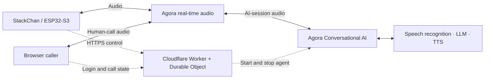

# Build a talking desktop robot with Agora and ESP32

Give a small desk robot a voice—and a way for friends to call it.

This recipe adapts Espressif's `esp-webrtc-solution` to M5Stack StackChan. Tap
the robot to talk to an AI companion powered by Agora Conversational AI. Open
your own caller website to start a separate, human-to-human Agora RTC call.
The robot keeps its simple eyes, mouth and blink animation.

**Developer preview.** The project has real AI conversation and two-way human
calling evidence. The portable instructions and packaging are new: a complete
fresh-machine, fresh-device walkthrough still needs to pass before we label
this a fully reproducible tutorial. See [release checks](docs/RELEASE-CHECKLIST.md).

<!-- Add the author's real demo video here before publication. -->

## What you will build

- A Wi-Fi-connected ESP32-S3 robot with touch-started AI conversation.
- A password-protected website for calling the robot from a browser.
- Separate AI and human channels, with no AI agent in the human call.
- A cloud control service; no always-on laptop backend during normal use.

## Architecture at a glance

ESP32 brings the conversation to a physical device. Agora connects its audio to
an AI agent or a remote person, while a small cloud service coordinates sessions.

Solid lines carry audio or AI processing; dotted lines coordinate sessions.
The diagram shows two separate modes, not one shared conversation:

- **Talk to AI:** tap StackChan to start a conversation. Agora Conversational AI
  connects speech recognition, the language model and text-to-speech in the cloud.
- **Call a person:** the browser calls StackChan through a separate Agora RTC
  channel. After acceptance, the browser publishes its microphone. No AI agent
  joins the human call.

| Component | What it handles |
| --- | --- |
| **ESP32-S3 + Espressif WebRTC components** | Microphone capture, speaker playback, touch input and the robot's face |
| **Agora** | Real-time audio transport and conversational AI sessions |
| **Cloudflare Worker + Durable Object** | Password login, temporary media credentials, agent lifecycle and call state |
| **Browser caller** | The calling interface, microphone selection, mute and audio levels |

Audio travels directly through Agora; it does not pass through the Worker or an
always-on laptop server. The App Certificate and provider keys stay server-side.
For call transitions, credential boundaries and source-file pointers, see the
[full architecture guide](docs/ARCHITECTURE.md).

Start with [the build guide](docs/GETTING-STARTED.md), then follow
[the two demo milestones](docs/TRY-IT.md). Read [the architecture](docs/ARCHITECTURE.md)
when you want to change the personality, voice or caller experience.

## Hardware and accounts

This adaptation targets the tested M5Stack StackChan/CoreS3 hardware with
ESP32-S3, ES7210 microphone codec, AW88298 speaker amplifier and ILI9342C screen.
A generic ESP32 board is not a drop-in substitute: it needs its own board/audio
port. Use a USB data cable and a password-based 2.4 GHz Wi-Fi network.

You need your own Agora project with Conversational AI access, the configured
LLM/TTS provider accounts, and a Cloudflare account for the Worker and SQLite
Durable Object. The current profile uses English recognition, DeepSeek and Fish
Audio. Provider access and service usage are subject to their respective terms
and billing; no free-usage allowance is assumed by this recipe.

## Start with voice

The recipe keeps head motion disabled. A battery-only startup/power issue and
an earlier motor timeout remain under investigation. The optional battery card
is a coarse voltage estimate, not a calibrated fuel gauge. The source baseline
uses speaker volume 55; a later volume-90 device experiment is not the default
or an acoustic-quality recommendation.

Useful starting points:

- [Espressif + Agora integration overview](https://developer.espressif.com/blog/2026/11/conversational-ai-esp32-agora/)
- [Espressif source](https://github.com/espressif/esp-webrtc-solution)
- [Agora Console](https://console.agora.io/)
- [M5Stack StackChan documentation](https://docs.m5stack.com/en/StackChan/)

This is an application example built on the integration. It is not an official
support promise for every ESP32 board or a production certification.
