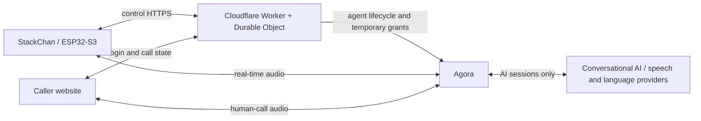

# How the robot connects

The device captures and plays audio through Espressif's media/WebRTC components.
Agora carries the real-time media. The Worker owns authentication, temporary
credentials, agent lifecycle and the single robot's call state. Browser audio
and robot audio do not pass through the Worker or the developer's laptop.

## Two experiences, two channels

For AI conversations, the service creates an agent and gives the robot a
short-lived WHIP grant for that session. The agent profile controls its greeting,
prompt and recognition language. The model runs in the cloud, not on the ESP32.

For human calls, the website requests a call. The robot announces the caller and
accepts by touch or a supported spoken decision. The service finishes the old
AI-session cleanup before issuing the isolated human-channel credentials. The
browser joins RTC and publishes its microphone only after acceptance. No AI
agent joins that human channel. Hanging up releases local tracks and ends the
session; if AI conversation was active before the call, the lifecycle can resume it.

This recipe does not use Bot Station pairing. Upstream Bot Station source may
exist in the checkout, but it is not the selected application entry point.

## Files to explore

| Location | Purpose |
| --- | --- |
| `firmware/stackchan-media.patch` | Board/audio, face, touch, WebRTC and call-state adaptation |
| `cloud/worker.py`, `cloud/state.py` | HTTP routing, Durable Object ownership and recovery |
| `cloud/provider.py` | Fetch-based Agora agent adapter for the Python Worker |
| `service/agent_profile.py` | Greeting, personality and recognition language |
| `service/stackchan_calls.py` | Call transitions and voice-decision handling |
| `service/web/index.html` | Caller interface, RTC tracks, mute and real volume meters |
| `cloud/caller_sessions.py` | Password login, session expiry and durable attempt limits |

The cloud adapter follows the project's working SDK payload mapping. It uses
Workers fetch rather than a socket-based server SDK in the Worker runtime.

## Credentials stay with their owners

The App Certificate and provider keys stay in Worker Secrets. The website
receives the App ID and short-lived RTC credentials. It holds its login token
in tab memory for eight hours; refreshing requires another password login.

The device contains its Wi-Fi credentials and a device-specific control key.
It never receives the App Certificate. Firmware and local provisioning files
therefore remain private even though their source templates are shareable.

The website is a shared-password, single-robot example. The `deviceId` passed
to `startCall` selects the browser microphone; it is not a robot identifier.
The service does not implement a multi-tenant fleet or per-caller accounts. Call grants are bounded;
this version does not promise indefinitely renewed calls.

## Customize one layer at a time

Change the greeting and prompt in `service/agent_profile.py` first. Keep the
agent's claims aligned with its capabilities: this version does not provide
camera vision or arbitrary motor tools. The current Fish Audio reference ID is
in `cloud/provider.py`; choose a voice you are authorized to use and validate
that your own account can access it. Changing `STT_LANGUAGE` alone is not proof
of end-to-end multilingual support.

The audio baseline uses shared-clock 16 kHz stereo 32-bit hardware I/O, microphone
gain 30 dB and reference gain 18 dB. AI and human modes use different AEC profiles.
Do not replace that path with the previously unsuccessful VOIP resampling path.
Volume is a codec scale, not measured sound pressure or a linear loudness percentage.
